# 系统架构与流程图

> **先看图**：`docs/architecture/diagrams/system-architecture.html`（系统组成）与
> `docs/architecture/diagrams/pipeline-workflow.html`（流水线内部）——
> 那两张是 archify 技能生成的可交互版本，经过校验门，是本项目的权威视图。
> 本文件是同样结构的 Mermaid 文本版，便于在 git diff / 不支持渲染的环境里查看。

本文件用 [Mermaid](https://mermaid.js.org/) 描述 `health-os-java` 的结构与运行路径。
GitHub / GitLab / VS Code（Markdown Preview Mermaid Support）/ Typora 均可直接渲染。

图与代码的对应关系写在每张图下面，方便按图索骥改代码。

---

## 1 系统上下文：谁在用，依赖什么

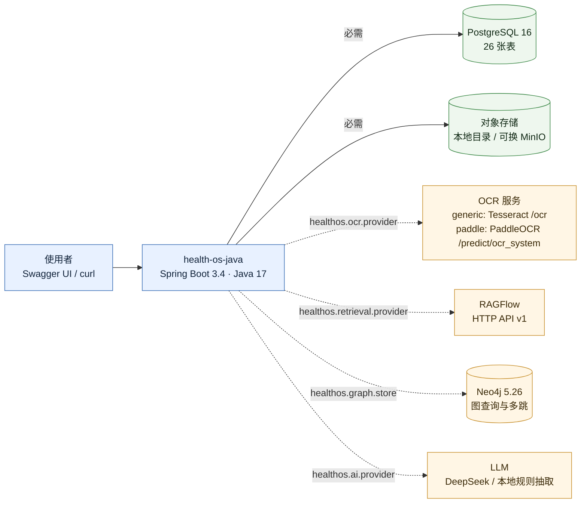

实线是**必需依赖**（缺了应用起不来或主链路不可用），虚线是**可选依赖**（默认关闭，关闭时不引入任何外部进程）。

对应代码：`config/OcrConfig`、`config/RetrievalConfig`、`config/GraphConfig`、`config/InfraConfig`。

---

## 2 分层结构：按技术角色分包

包名一律 `{角色}/{业务域}`：`controller` / `service` / `mapper` / `model` / `contract` /
`spi` / `provider` / `worker` / `text` 是角色，`classics` / `patient` / `qa` / `tracing` 等是业务域。

```mermaid
flowchart TB
    subgraph API["controller 层 · HTTP 出入口"]
        direction LR
        C1["AuthController"]
        C2["ClassicsController"]
        C3["GraphController"]
        C4["QaController<br/>QaRunController<br/>QaKnowledgeController"]
        C5["PatientController<br/>PatientBatchController<br/>PatientDeletionController<br/>PatientMaintenanceController"]
        C6["HealthController"]
        C7["TracingController"]
        C8["CareController"]
    end

    subgraph CONTRACT["contract 层 · 请求/响应 record"]
        direction LR
        CT["ClassicContract / GraphView<br/>QaContract / PatientContract<br/>CareContract / KnowledgeBindingContract<br/>TracingContract"]
    end

    subgraph SERVICE["service 层 · 业务编排"]
        direction LR
        S1["PipelineOrchestrator"]
        S2["PipelineService"]
        S3["DocumentNormalizer"]
        S4["ExtractionMerger"]
        S6["QaService"]
        S7["PatientService"]
        S8["PatientLifecycleService<br/>PatientObjectService<br/>PatientBatchService<br/>PatientDeletionService<br/>PatientOrphanService"]
        S9["TracingService<br/>TraceQueryService<br/>TraceRetentionService"]
        S10["CareService<br/>CareExportService（JSON/PDF 导出）<br/>CarePdfRenderer（字体探测 + 排版）"]
        S11["ClassicArtifactService（产物查询）<br/>KnowledgeBindingService（患者 ↔ 知识库）"]
    end

    subgraph TEXT["text 层 · 纯算法（无状态 / 无 Spring 依赖）"]
        direction LR
        T1["TextSegmenter<br/>切片与二分"]
        T2["EvidenceLocator<br/>引用 → 字符区间 + 页码"]
    end

    subgraph PORT["spi 层 · 扩展点接口，业务只依赖抽象"]
        direction LR
        P1["OcrProvider"]
        P2["KnowledgeBase"]
        P3["GraphStore"]
        P4["LlmProvider"]
        P5["ObjectStorage"]
        P6["TraceWriter"]
    end

    subgraph ADAPTER["provider 层 · 实现，按配置装配"]
        direction LR
        A1["Disabled / Http OCR"]
        A2["Local / Ragflow / Hybrid"]
        A3["Jdbc / Neo4j / Dual"]
        A4["Template / OpenAI 兼容"]
    end

    subgraph DATA["mapper + model 层 · MyBatis-Plus"]
        direction LR
        M1["*Mapper"]
        M2["*Entity"]
    end

    CLIENT["调用方"] --> API
    API --> CONTRACT
    API --> SERVICE
    SERVICE --> PORT
    PORT --> ADAPTER
    SERVICE --> DATA
    DATA --> DB[("PostgreSQL")]
    ADAPTER --> EXT["外部服务"]
    SERVICE --> TEXT
    ADAPTER --> TEXT
    WORKER["worker 包<br/>ClassicIngestHandler<br/>PatientBatchImportHandler<br/>PatientDeletionHandler"] --> SERVICE

    classDef layer fill:#f5f8fc,stroke:#8aa4c4,color:#1b2a3a
    classDef port fill:#fff6e5,stroke:#c8912f,color:#3b2a08
    classDef ext fill:#eef7ee,stroke:#3f8a4a,color:#122a16
    class API,CONTRACT,SERVICE,DATA,TEXT layer
    class PORT port
    class ADAPTER,DB,EXT ext
```

要点：`service` 只 import 接口，从不 import 具体实现——所以换 OCR 引擎、换图库、换模型都不用改业务代码。

`text` 是唯一被**上下两层都引用**的包，因为它装的是没有归属的纯算法：切片与"引用 → 原文区间"的定位
既被 classics 流水线用，也被检索与图存储的实现用。放在任何一方都会让另一方反向依赖，
所以单独成层——它无状态、无 Spring 依赖，被谁引用都不会带出传递依赖。

`worker` 单独成包，因为它是**被调度器驱动**的入口，不是被 HTTP 驱动的入口。

反向的边一条都没有：`provider` 不 import `service`，`spi` 不 import 实现，
`common` 不 import `config`——这几条由 `tools/check-layering.py` 机械校验（含 javadoc 里的 `{@link}`）。

---

## 3 主链路时序：上传 → READY

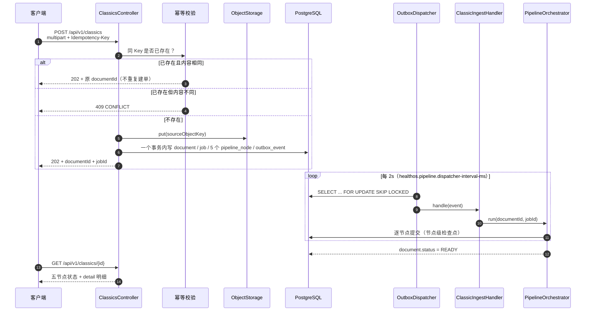

**为什么上传是异步的**：OCR 一页几百毫秒、解析一轮几秒，同步等会让 HTTP 连接长时间占着。
`202` + 轮询是这个场景的正确形态，代价是客户端要自己轮。

对应代码：`controller/classics/ClassicController`（建单）→ `service/outbox/OutboxService`（落事件）→
`service/outbox/OutboxDispatcher`（认领）→ `worker/classics/ClassicIngestHandler`（分发）→ `PipelineOrchestrator#run`。

---

## 4 五节点流水线与归一化分支

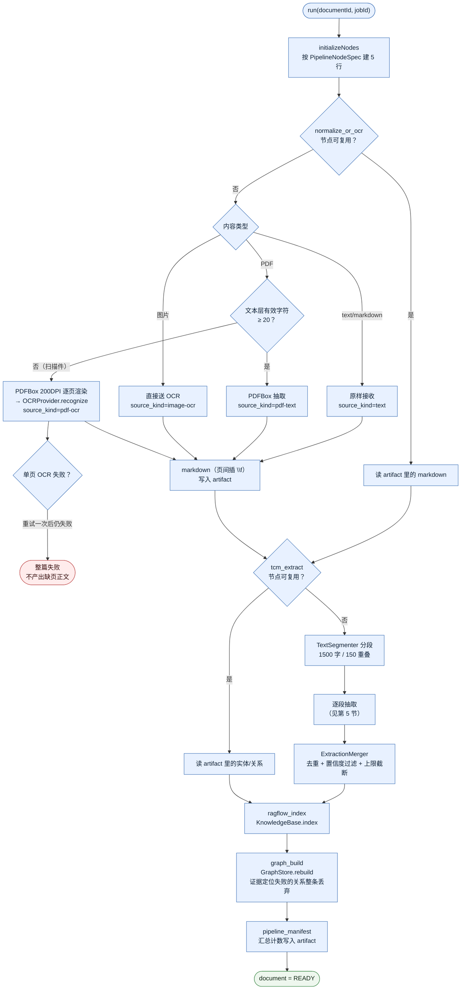

每个节点完成即提交，所以**中途失败不丢已完成节点的成果**；重跑时 `reusable()` 为真的节点直接跳过。
这就是"重试秒级完成"的原因。

---

## 5 单段抽取的决策路径（重试 / 二分 / 检查点）

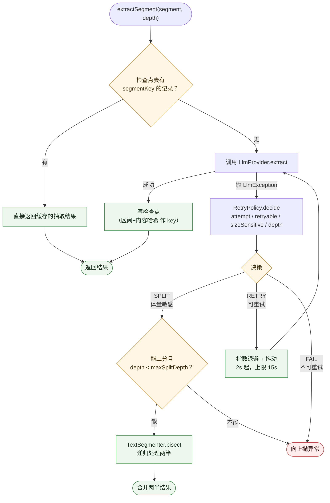

三个关键点：

1. **体量敏感错误不浪费一次重试**——多半是"这段太长导致模型返回被截断"，重试同样的长度只会再失败一次，直接二分。
2. **检查点键用「区间 + 内容哈希」而不是分段序号**——二分后序号会变，用序号会让缓存全部失效。
3. **二分受 `maxSplitDepth` 限制**——防止把 20 字的段落切成单字，那时模型更抽不出东西。

对应代码：`service/classics/PipelineOrchestrator#extractSegment`、`RetryPolicy`、`Segment#checkpointKey`。

---

## 6 三态装配与降级

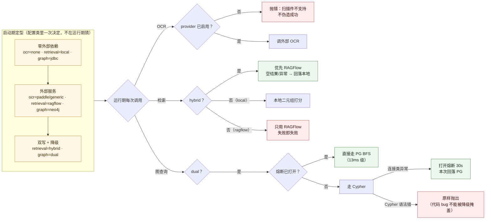

健康检查的判定口径刻意分开：

| 情况 | `/health/dependencies` | `status` |
|---|---|---|
| 未启用（`none` / `local` / `jdbc`） | `disabled` | 不影响，仍 `ready` |
| 已启用且可达 | `ok` / `hybrid:ok` / `dual:ok` | `ready` |
| 已启用但不可达 | `unavailable` | `degraded` |

"没配"和"配了但挂了"在运维上是两件事，混成一个信号会让面板永远黄着没人看。

---

## 7 问答链路

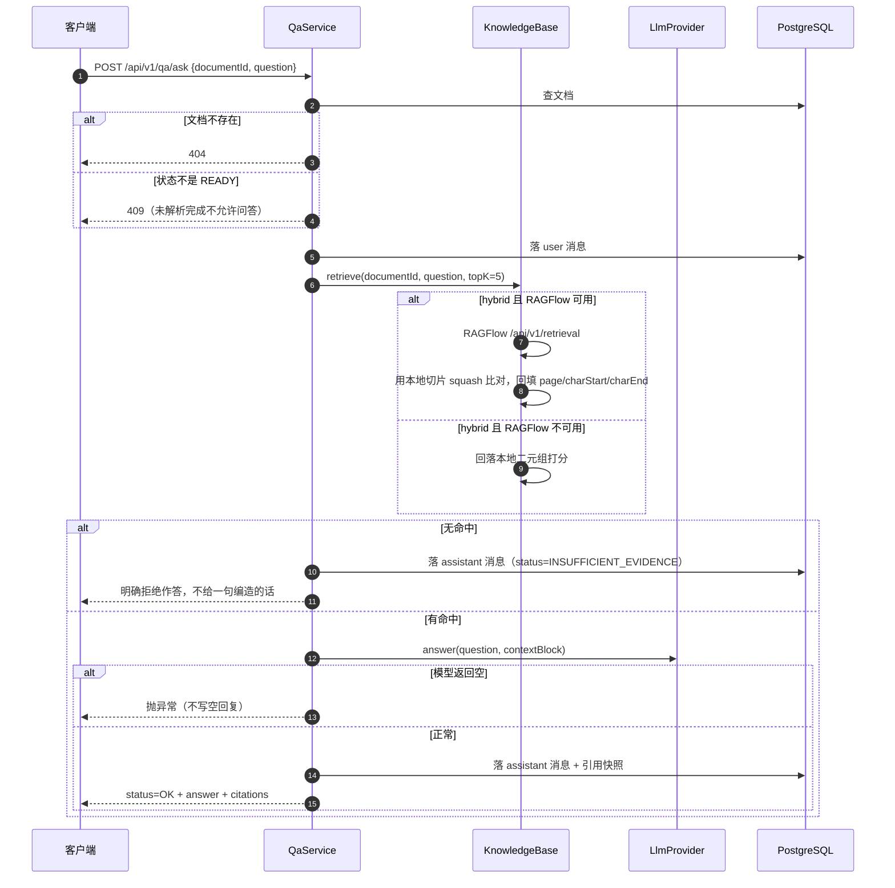

引用是**快照**：`qa_message.citations` 存的是当时的原文片段与页码，
后面图谱重建也不会改掉历史回答的出处。

### 7.0.1 患者知识库：把"这位患者的资料"也纳入依据

`documentId` 那条路只能看**一份**典籍。真实场景里医生问的是"这位患者怎么样"，
依据一半在典籍、一半在患者自己的随访记录里，而后者往往被单独放进了另一个知识库。

绑定关系落在 `qa_knowledge_binding`（`owner` + `patient_id` + `dataset_id`），
`/qa/ask` 带 `patientId` 时多走一次跨库检索并**合并**：

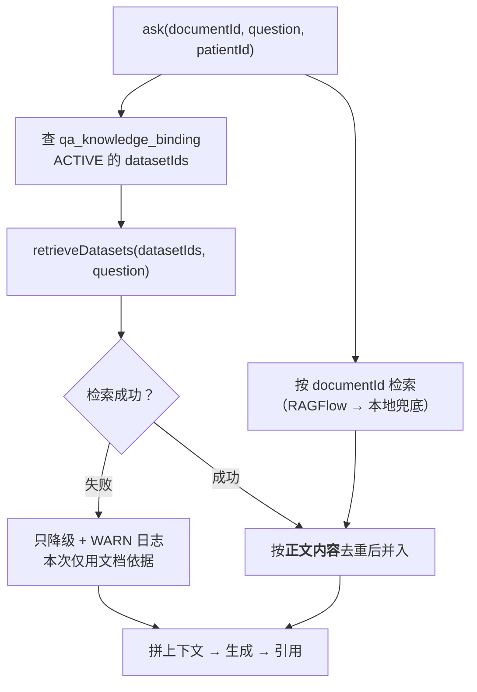

四条规则，每条都是踩过坑才写上去的：

| 规则 | 为什么 |
|---|---|
| 去重键用**内容哈希**，不用 `chunkId` | 本地切片与 RAGFlow 切片是两份独立产生的 ID，同一段正文 ID 不同。按 ID 去重会把同一段喂给模型两遍，`citations` 里出现两条一模一样的引用 |
| **不跨来源重排** | RAGFlow 相似度与本地二元组分不是同一把尺子，混排等于编一个不存在的序。合并只做"追加"，各自的分数各自用 |
| 跨库命中**逐条按自带 `documentId`** 回填偏移 | 曾用固定文档去本地切片表定位，跨库时几乎全部补不上，引用集体丢页码 |
| 外部 `document_id` **映射回本系统典籍 ID** | 否则引用里只剩一个点不开的 RAGFlow ID。映射依据是 `knowledge_index.external_doc_id`——索引时写下的对应关系，不是从命名字符串里猜的；查不到就留 `null`，不拿假 ID 充数 |

绑定库的检索**只能走 RAGFlow**——本地模式没有"库"这个概念。所以 RAGFlow 不可用时
患者那一路整体降级，日志里留 `患者知识库检索失败`，不会静默变成"这位患者没有资料"。

---

## 7.1 持久化问答运行（qa run）

第 7 节那条路是**一次性同步问答**：请求返回时答案已经在手里。
但问答可能跑十几秒，途中进程重启、客户端断线、网络抖一下，前面的算力就白扔了。
持久化 run 把一次问答拆成节点逐个落库，让它可观察、可重试、可续。

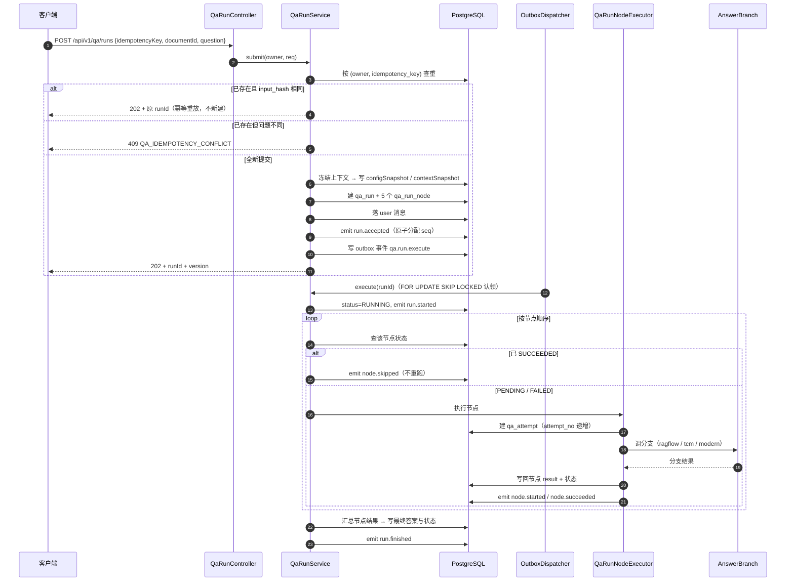

### 7.1.1 四张表

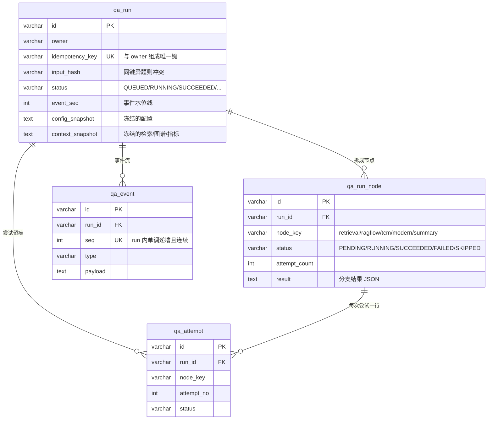

### 7.1.2 事件流与断点续传

事件类型：`run.accepted` / `run.started` / `node.started` / `node.succeeded` /
`node.skipped` / `node.failed` / `run.retry` / `run.finished` / `run.failed`。

`seq` 由 `UPDATE qa_run SET event_seq = event_seq + 1 ... RETURNING event_seq` 原子分配，
**run 内连续无空洞**。客户端记住最后收到的 SSE `id`（就是 seq），
重连时带上 `afterSeq`，服务端只补之后的事件：

```
GET /api/v1/qa/runs/{runId}/events?afterSeq=8&limit=100   →  [9, 10, 11, 12]
GET /api/v1/qa/runs/{runId}/stream?afterSeq=8              →  SSE，从 9 开始推
```

SSE 走 `text/event-stream`，每条消息三段：

```
id:9
event:node.started
data:{"seq":9,"type":"node.started","payload":{"attempt":1,"nodeKey":"tcm"},"createdAt":"..."}
```

### 7.1.3 三条容易踩的规则

1. **幂等键按 `(owner, idempotency_key)` 唯一，不是 `(conversation_id, idempotency_key)`**。
   会话是可选的——按会话查重会让"不带会话的重复提交"每次都建新会话、绕过幂等。
2. **续跑用冻结值，不用当前值**。上下文在提交那一刻冻结进 `context_snapshot`，
   重跑节点时读的是它，不是重新检索一遍。依据不变，答案才可比。
3. **重试失败节点时，`summary` 必须一并重置为 `PENDING`**。
   汇总读的是各分支的落库结果；分支换了新结果而汇总不重算，最终答案还是上一轮的。
   事件载荷里 `nodes` 是用户点名的节点、`rerun` 是实际会跑的节点，两者可能不同。

对应代码：`service/qa/run/QaRunService`（编排）、`QaRunNodeExecutor`（节点生命周期）、
`QaRunStreamService`（SSE 推送）、`worker/qa/QaRunHandler`（Outbox 分发）、
`service/qa/BranchAggregator`（汇总规则，与同步路径共用同一份）。

---

## 8 数据表与域划分

```mermaid
erDiagram
    classic_document ||--o{ classic_job : "多次尝试"
    classic_job ||--o{ pipeline_node : "五节点"
    classic_job ||--o{ artifact : "产出"
    classic_document ||--o{ extraction_checkpoint : "分段检查点"
    classic_document ||--o{ document_chunk : "本地切片"
    classic_document ||--o{ chunk_vector : "切片向量（按模型分套）"
    classic_document ||--o{ knowledge_index : "外部知识库登记"
    classic_document ||--o{ graph_entity : "实体"
    classic_document ||--o{ graph_relation : "关系"
    graph_relation ||--o{ evidence : "每条边至少一条出处"
    classic_document ||--o{ qa_conversation : "问答会话"
    qa_conversation ||--o{ qa_message : "消息"
    patient ||--o{ patient_metric : "指标"
    patient ||--o{ patient_revision : "每次改动一版快照"
    patient ||--o{ patient_object : "附件"
    patient ||--o{ patient_deletion_task : "删除申请"
    patient_deletion_task ||--o{ patient_deletion_resource : "待擦除清单"
    patient_batch ||--o{ patient_batch_row : "逐行结果"
    patient ||--o{ qa_knowledge_binding : "绑定患者知识库"
    patient ||--o{ care_document : "照护报告 / 计划"
    care_document ||--o{ care_revision : "每次改版一版快照"
    care_document ||--o{ care_audit : "操作留痕"
    care_document ||--o{ care_signature : "签发"
    care_document ||--o{ care_checkin : "计划打卡"
    patient_intake_exam ||--o{ patient_intake_part : "分片抽取"
    patient_intake_exam }o--o| patient : "确认后建档"
    trace_run ||--o{ trace_span : "一次执行里的操作"
    trace_run ||--o{ trace_event : "零散事实"
    outbox_event }o--|| classic_document : "事件载荷"
    idempotency_record }o--|| classic_document : "幂等键"
    model_routes ||--o{ model_route_versions : "只追加的历史"
    model_routes ||--o{ model_credentials : "同一主线的多版密钥"
    model_routes ||--o{ model_route_probes : "能力探测留痕"
    model_routes ||--o{ model_usage : "按主线的逐次花费"
    agent_run ||--o{ agent_node : "角色节点与校验节点"
    agent_run ||--o{ agent_run_event : "只追加的事件流（每 run 单调 seq）"
    agent_run ||--o{ agent_mcp_receipt : "工具调用回执"
    qa_conversation ||--o{ qa_memo : "被收藏的消息"
    qa_conversation ||--o{ qa_diagnostic : "单路检索诊断"
    patient ||--o{ patient_review_draft : "录入审阅草稿（basic/clinical）"
    patient ||--o{ memory_agent_note : "记忆摘录候选"
    care_document ||--o{ care_document : "发布基线 / 修订来源"

    classic_document {
        string id PK
        string title
        string status "UPLOADED/PROCESSING/READY/FAILED"
        string sha256
        string source_object_key
    }
    pipeline_node {
        string id PK
        string code "normalize_or_ocr ... pipeline_manifest"
        string status
        json detail "页码/引擎/条数/降级原因"
    }
    chunk_vector {
        string id PK
        string chunk_id FK "(chunk_id, model) 唯一"
        string document_id FK
        string model "ollama:bge-m3；换模型等于另一套向量"
        int dimension
        text vector "JSON 数组，已 L2 归一化（不依赖 pgvector）"
        string content_hash "正文变了才重算"
        timestamp created_at
    }
    model_usage {
        string id PK
        string scope_key "主线 pipelineKey，配额按它统计"
        string provider_id
        string model
        int prompt_tokens
        int completion_tokens
        int total_tokens
        int cached_prompt_tokens "命中前缀缓存的部分（含在 prompt_tokens 内）"
        bigint cost_micros "可为 NULL：没配单价就不猜"
        string currency
        string trace_id
        timestamp created_at
    }
    graph_relation {
        string id PK
        string source_id FK
        string target_id FK
        string type "组成/功效/主治/归经"
        numeric confidence
        int page_from "冗余页码，便于直接展示"
    }
    evidence {
        string id PK
        string relation_id FK
        string quote "原文片段"
        int page
        int char_start
        int char_end
    }
    patient {
        string id PK
        string status "DRAFT/ACTIVE/ARCHIVED/DELETED"
        int revision "乐观锁版本，每次写入 +1"
        string external_ref "外部系统编号，唯一"
        timestamp archived_at
        timestamp deleted_at
    }
    patient_revision {
        string id PK
        string patient_id FK
        int revision "与 patient.revision 对齐，(patient_id,revision) 唯一"
        string snapshot "整档 JSON 快照"
        string sha256 "快照内容哈希，可校验"
    }
    qa_knowledge_binding {
        string id PK
        string owner "归属人，逐表过滤，越权一律 404"
        string patient_id FK
        string dataset_id "RAGFlow 数据集 ID；(owner,patient_id,dataset_id) 唯一"
        string dataset_name "冗余存名字，reconcile 失败时仍能展示"
        string status "ACTIVE / STALE"
        timestamp last_checked_at
        string last_error "失效原因，失败要看得见"
    }
    patient_memory_version {
        string id PK
        string owner
        string patient_id FK
        int version "(patient_id,version) 唯一"
        string content_hash "sha256(markdown)"
        string source_hash "sha256(去掉采样时间的来源清单)"
        string data "事实快照 JSON"
        string sources "逐条来源 + content_hash"
        string markdown "渲染结果"
        timestamp sampled_at
    }
    patient_memory_state {
        string patient_id PK
        string owner
        string current_memory_id FK "当前发布指针"
        int version
    }
    patient_followup {
        string id PK
        string owner
        string patient_id FK
        string operation_id "(patient_id,operation_id) 唯一，幂等"
        int request_sequence "patient 行锁串行分配"
        string entries "原文 JSON，不摘要不改写"
    }
    patient_memory_job {
        string id PK
        string owner
        string patient_id FK
        string operation_id "(patient_id,operation_id) 唯一"
        int request_sequence
        string request_hash "内容幂等校验"
        string kind "followup_refresh / explicit_refresh"
        string expected_memory_id "乐观并发"
        string status "QUEUED/RUNNING/SUCCEEDED/FAILED/CANCELLED"
        int attempt_count
        string error "失败要看得见"
    }
    trace_run {
        string trace_id PK "32 位十六进制"
        string root_span_id "16 位十六进制"
        string business_type "classic_document / qa_ask"
        string business_id
        int execution_no "同一对象第几次执行，重跑递增"
        string previous_trace_id "链到上一次执行"
        string status "健康度：RUNNING/SUCCEEDED/FAILED/INTERRUPTED"
        string outcome "业务原生状态，不参与聚合"
        timestamp expires_at "写入时算好，保留清理按它删"
    }
    trace_span {
        bigint id PK
        string trace_id FK
        string parent_span_id "根 span 为空，孤儿加 warning"
        string kind "business/business_stage/model/retrieval/graph"
        string service "聚合维度，影响 overview.byService"
        int duration_ms
    }
    model_routes {
        string pipeline_key PK "REPORT/QA/AGENT/MEMORY/EXTRACTION/GRAPH/EMBEDDING"
        string current_version_id FK "当前生效的版本行"
        string owner "最后改配置的账号"
        timestamp updated_at
    }
    model_route_versions {
        string id PK
        string pipeline_key FK
        int version "(pipeline_key,version) 唯一，单调递增"
        string config "规范化后的配置 JSON"
        string config_fingerprint "HMAC-SHA256(主密钥, 规范化配置+密钥)"
        string changed_by "变更人"
        string change_reason "为什么改"
        timestamp created_at
    }
    model_credentials {
        string id PK
        string pipeline_key FK
        int version "(pipeline_key,version) 唯一"
        string cipher "AES-256-GCM 密文"
        string key_id "主密钥指纹；主密钥换了就解不开"
        string aad "AAD 绑定 pipeline/credential/version"
        timestamp created_at
    }
    model_route_probes {
        string id PK
        string pipeline_key FK
        string capability "connectivity/structured/streaming/tool_calling"
        string status "passed/failed"
        int latency_ms
        string error_code "失败要看得见"
        string resolved_model "供应商实际命中的模型名"
        timestamp probed_at
    }
    agent_run {
        string id PK
        string owner "归属人，越权读 404"
        string patient_id FK
        string scenario "progress/execution/statistics"
        string scopes "授权范围 JSON"
        string operation_id "(owner,patient_id,operation_id) 唯一，幂等"
        string request_fingerprint "场景+范围+指令的摘要；与 result 分列"
        string status "QUEUED/RUNNING/SUCCEEDED/FAILED/CANCELLED"
        string result "最终结果 JSON：答案+角色状态+已核验事实"
        string graph_version "依赖图版本"
        int event_seq "事件序号水位，UPDATE ... RETURNING 原子分配"
        int version "控制面乐观锁（cancel/retry 带 expectedVersion）"
        timestamp deadline_at "超时判定边界，节点边界检查"
    }
    agent_node {
        string id PK
        string run_id FK
        string role "四个角色之一"
        string kind "role/validation"
        string status "succeeded/failed/skipped/cancelled"
        string output "角色产出 JSON"
        string output_hash "交接完整性凭据：sha256(output)"
        string error "错误码"
        int ordinal "执行顺序"
    }
    agent_run_event {
        string id PK
        string run_id FK
        int seq "(run_id,seq) 唯一；事件流的排序与断点游标"
        string type "run.queued / node.completed / run.succeeded ..."
        string node_id FK "节点级事件才有"
        string status "发生后的状态快照"
        text detail "只落库不出接口（可能含模型输入片段）"
        timestamp created_at
    }
    agent_mcp_receipt {
        string id PK
        string owner "归属人"
        string patient_id FK
        string kind "probe / call"
        string status "running / succeeded / failed（越权工具即 failed + MCP_TOOL_REJECTED）"
        text request "入参快照（工具名、scopes、指令摘要）"
        text detail "错误码与握手耗时"
        timestamp created_at
        timestamp completed_at "先以 running 独立提交，崩溃后停在 running"
    }
    qa_memo {
        string id PK
        string owner
        string patient_id
        string conversation_id FK
        string source_message_id "唯一：同一条消息只能收藏一次"
        string question "收藏那一刻的问，冻结"
        text content "收藏那一刻的答，冻结"
        string content_hash "正文哈希，可校验未被改写"
        string evidence_snapshot "引用快照 JSON，不随源数据变化"
        string source_versions "来源版本快照"
        timestamp created_at
    }
    qa_diagnostic {
        string id PK
        string owner
        string conversation_id FK
        string operation_key "唯一：幂等键"
        string mode "ragflow_diagnostic（只跑检索一路）"
        string status "运行层：QUEUED/RUNNING/SUCCEEDED/FAILED"
        string result "结论层：executionStatus/retrievalStatus/resultKind/usableForSummary"
        string draft "失败时保留，供下次重试"
    }
    patient_review_draft {
        string id PK
        string owner
        string exam_id FK
        string scope "basic / clinical"
        int base_revision "起草时所基于的正式修订"
        int version "草稿自身的乐观锁（请求侧叫 expectedVersion）"
        text payload "白名单字段；绝不写正式修订"
        timestamp updated_at
    }
    memory_agent_note {
        string id PK
        string owner
        string patient_id FK
        string job_id
        string feedback_id "来源随访/打卡"
        string operation_id "(owner,patient_id,operation_id) 唯一"
        string status "PENDING / PUBLISHED"
        text observations "逐字摘录数组（每条 content.contains(quote) 校验）"
        string candidate_hash "发布时校验，防候选被改"
        string source_hash "来源快照哈希，变了就拒发布"
        string model_node_id "产出来源的模型节点"
        string memory_id "发布后指向的记忆版本"
        timestamp published_at
    }
```

`evidence` 与 `graph_relation` 是 1:N，但业务上要求**每条关系至少一条证据**，
定位失败的关系会被整条丢弃并计入 `dropped_relations`。

---

## 9 关键路径的失败点对照

| 位置 | 失败表现 | 后果 | 重试行为 |
|---|---|---|---|
| 归一化 · 扫描件但 OCR 未启用 | `BizException` | 文档 `FAILED`，`source_kind` 不写 | 重试也不会成功，需先配 OCR |
| 归一化 · 单页 OCR 失败 | 重试一次后抛错 | 整篇失败（不产出缺页正文） | 重试整个节点 |
| 抽取 · 模型 413 / 输出截断 | `sizeSensitive` | 自动二分重跑 | 不消耗常规重试次数 |
| 抽取 · 模型 5xx / 超时 | `retryable` | 指数退避 | 2s→15s，最多 `segment-max-attempts` 次 |
| 抽取 · 模型返回非法 JSON | `!retryable` | 立即失败 | 无 |
| 索引 · RAGFlow 挂 | `hybrid` 记 `degraded` | 节点仍成功，检索回落本地 | 下次调用重新尝试 |
| 图谱 · Neo4j 挂 | `dual` 记 `degraded` | 节点仍成功，查询走 PG | 熔断 30s 后自动回切 |
| 图谱 · 证据定位失败 | 记 `dropped_relations` | 该关系不入库 | 不重试（重试也定不到） |
| 问答 · 无命中 | `INSUFFICIENT_EVIDENCE` | 明确拒绝作答 | — |
| 问答 · 模型返回空 | 抛异常 | **不写空回复** | — |

这张表是"不伪造成功"原则的落地清单：每一行都对应一处**宁可失败也不给假结果**的选择。

---

## 10 观测：轨迹怎么产生、怎么写、怎么被查

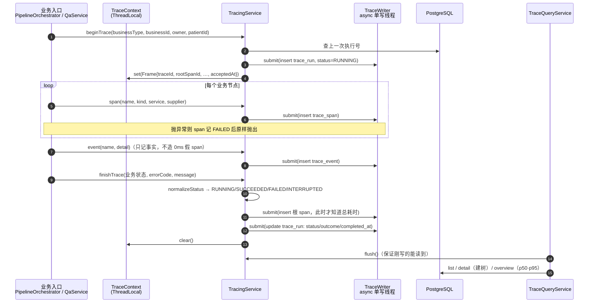

三条设计取舍，改动前先想清楚：

1. **轨迹不在业务事务里**。业务回滚时最需要看失败轨迹，同事务会把证据一起回滚掉。
   代价是可见性有毫秒级延迟，所以 `TraceQueryService` 每个入口先 `flush()`。
2. **写入不许反压业务**。`async` 是单写线程 + 有界队列，满了丢并计数
   （`/health/dependencies` 显示 `dropped=N`），绝不阻塞调用方。
3. **跨线程必须搬 Frame**。分支线程池里的 span 依赖 `tracing.callIn(frame, …)`，
   否则上下文为空、span 直接消失。这也是跨进程断链的根因——没有传 `traceparent` 头。

保留清理按写入时算好的 `expires_at` 分批删（默认每日 03:30，也可手动触发，
`dryRun` 默认 `true`），再按 cutoff 兜底清孤儿 span/event。

---

## 11 患者域：状态机、批次与四段式删除

### 11.1 状态流转

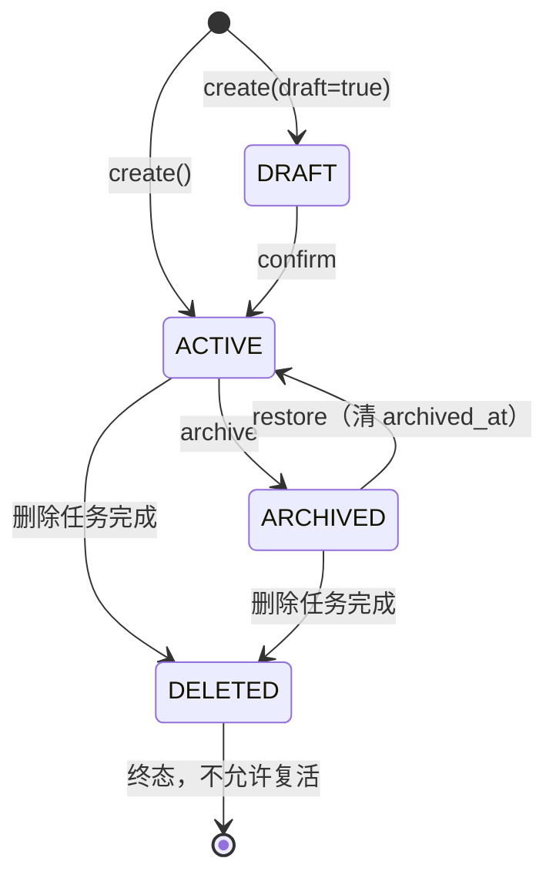

每次流转都带 `expectedRevision`：`UPDATE … WHERE revision = ?`，影响 0 行即
`409 PATIENT_REVISION_CONFLICT`。`patient_revision(patient_id, revision)` 的唯一约束
是并发保护的最后一道——两个请求同时过了乐观锁，也会在快照插入时撞库。

### 11.2 批次导入

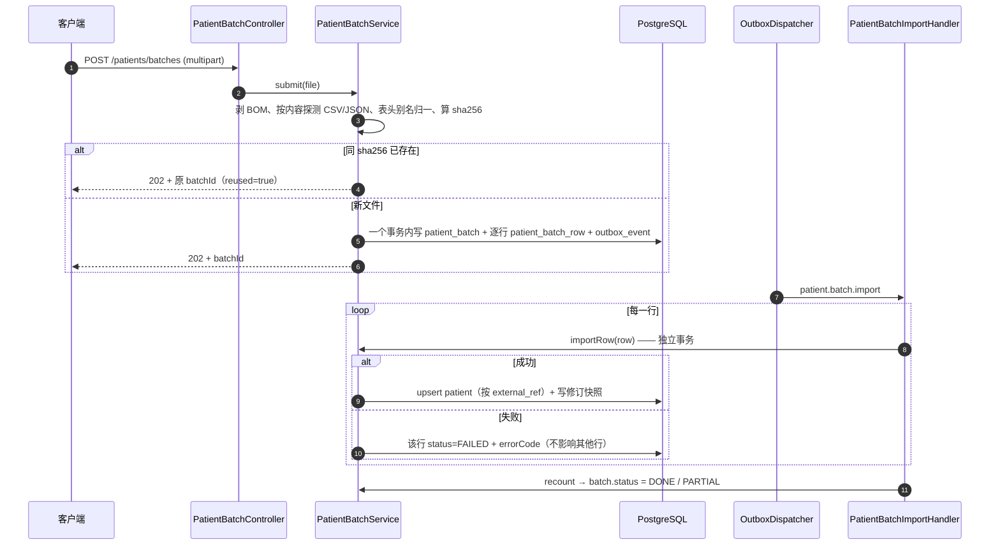

**逐行独立事务**是有意的：一行生日格式写错不该让整批回滚。
代价是"部分成功"成为常态，调用方必须读 `ok`/`fail` 而不是只看 HTTP 200。

### 11.3 删除四段式

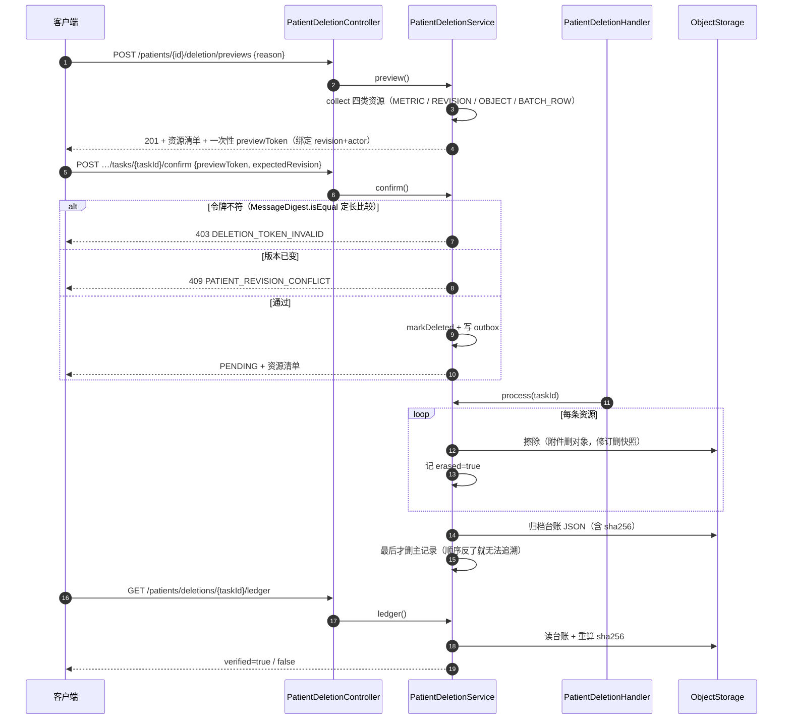

为什么不是一个 `DELETE` 完事：预览返回的令牌与版本号一起构成"你确实看过这份清单、
且档案没变"的凭据。台账是"删除确实发生过"的唯一证据，所以它落在对象存储（不随业务表删掉），
并带 `sha256` 供回读校验。

孤儿扫描（`GET /patients/maintenance/orphans`）**只读**；清理必须显式点名 key，
`../` 越界与仍被引用的 key 会被跳过并回报——不提供"删全部孤儿"这种一按就不可逆的接口。

### 11.4 资料录入：上传 → 建档

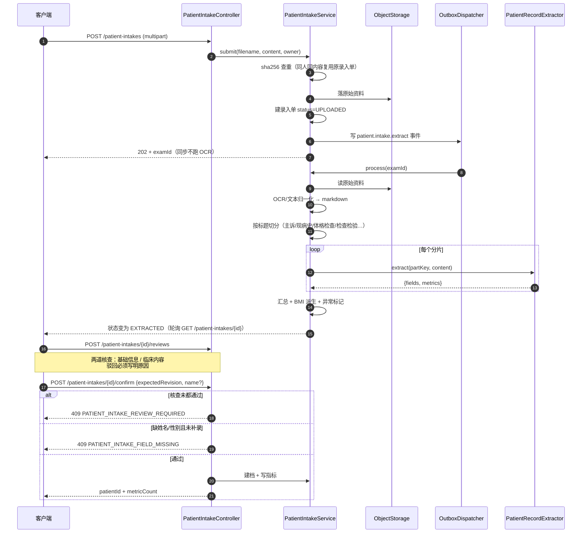

三条设计取舍：

1. **AI 只负责"抄"，签字的是人**。两道核查（基础/临床）都 `CONFIRMED` 才允许生成档案；
   不设"AI 直接建档"的捷径。
2. **每片独立成败**。一段抽坏了不该让整份资料作废，
   但只要有一片失败，档案就不许确认——残缺的档案比没有档案更危险。
3. **提交与执行分离**。上传只落库 + 写 outbox 就返回，
   OCR 与抽取都在 worker 里跑，HTTP 请求不会被 OCR 拖死。

**抽取器不许猜值**：原文里没有的字段一律不出现在结果里。
缺字段由人工在 `confirm` 时补录（`name`/`gender`/`birthDate`/`phone`），
补录优先于抽取结果，且来源标注为 `manual` 写回汇总——
日后看到"姓名=王五"能直接分辨是人补的还是机器抄的。

**幂等与重试**：同一归属人重复上传同一份资料复用原录入单（不重跑 OCR）；
但失败的录入单允许重新上传重试（清旧分片 → 回 `UPLOADED` → 重排事件），
上一轮 OCR 挂了不该让这份资料永远卡死。


---

## 12 认证与授权：一次请求怎么被认出来

```mermaid
sequenceDiagram
    autonumber
    participant C as 客户端
    participant API as AuthController
    participant RES as CurrentUserArgumentResolver
    participant S as AuthService
    participant T as SessionToken
    participant R as SessionRevocationRegistry
    participant L as LoginThrottle
    participant ACL as AccessControl

    C->>API: POST /auth/login {username, password}
    API->>S: login(user, pass, ip)
    S->>L: requireAllowed(user)
    alt 已锁定
        L-->>API: 429 TOO_MANY_REQUESTS
    end
    S->>S: PasswordHash.matches(pass, stored)
    alt 口令不符
        S->>L: recordFailure(user)
        S-->>C: 401 用户名或口令不正确
    else 通过
        S->>L: recordSuccess(user)
        S->>T: issue(subject, ttl) → token + Session(jti, exp)
        T-->>API: token
        API->>ACL: rolesOf(subject)
        ACL-->>API: [ADMIN, TRACE_READER?, USER]
        API-->>C: Set-Cookie(HttpOnly; SameSite=Lax) + {roles, expiresAt}
    end

    C->>RES: 任意受保护接口（带 Cookie）
    RES->>T: read(token) → Session
    RES->>R: isRevoked(jti)
    alt 已吊销 / 签名错 / 过期
        RES-->>C: 401
    else 有效
        RES->>ACL: rolesOf(subject)
        RES->>RES: 剩余 < TTL/3 → renew（沿用 jti）并回写 Set-Cookie
        RES-->>C: 放行，注入 UserPrincipal（或 String 用户名）
    end

    C->>API: POST /auth/logout
    API->>R: revoke(jti, exp)
    API-->>C: 204 + Max-Age=0
```

三条不可让步的语义：

1. **身份与授权分离**。令牌载荷只有 `{v, sub, jti, iat, exp}`，**不含角色**。
   角色每次请求由 `AccessControl#rolesOf` 按当前白名单现算——把某人从运维名单移走立即生效，
   不用等 8 小时令牌过期。
2. **登出是真吊销**。`jti` 进吊销名单，抄走的 Cookie 在到期前也失效。
   只清 Cookie 的那种"登出"，攻击者手上的令牌还能一直用。
3. **续期沿用原 `jti`**。换标识会让"登出 → 刚续出来的新令牌"绕过吊销名单，
   这个洞不会报错，只会静默存在。

吊销名单与限流计数都在进程内存：**单实例够用，集群化必须换共享存储**
（重启清空、多实例不共享），这一点写在 README §9 差异清单里，不含糊过去。

---

## 13 照护文档：签发语义与导出

报告和计划共用 `care_document` 一张表，靠 `kind` 分流。两者都要经过"编辑 → 签发/确认"，
签发后才是一份可对外的东西——这个边界不是流程装饰，而是导出接口的准入条件。

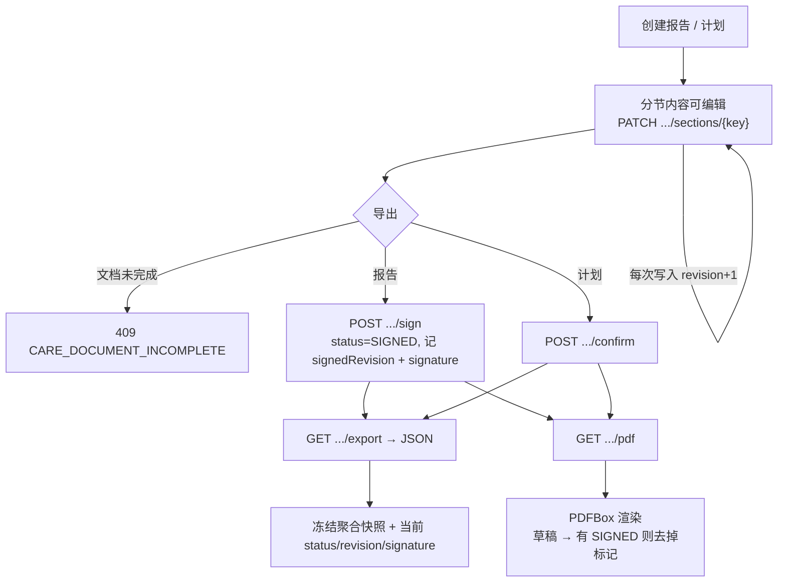

**导出 JSON 的语义**：分节内容取自**冻结的聚合快照**（编辑中途不会半新半旧），
但 `status` / `revision` / `signature` 取**当前值**。混用这两者的后果很实际——
用快照里的旧状态，会把已签发的文档导成"草稿"，下游按草稿处理就白签了。

**PDF 的三条硬约束**（都不是风格问题，是能不能出字的问题）：

| 约束 | 说明 |
|---|---|
| **必须内嵌真实字体** | PDFBox 没有内置 CJK 字体。reportlab 那边的 `STSong-Light` 是**字体名引用**，依赖阅读器本地有该字体；照搬到 PDFBox 就是在客户机上看方块 |
| `.ttc` 不能在 `save()` 前关闭 | 集合对象要活到子集化写盘（`save()`）那一刻才被读字形，提前 close 会得到空字形 |
| 探测不到字体就 `503` | 宁可明说"这台机器没有中文字体"，也不生成一份看着正常、实际全是方块的 PDF |

字体查找顺序：显式配置 `healthos.care.pdf.font-path` → 该路径若是目录则展开 →
候选列表（`msyh.ttc` / `wqy-microhei.ttc` / `NotoSansCJK-Regular.ttc` 等）。
启动时用空文档试加载一次，结果暴露在 `/health/dependencies` 的 `carePdf` 字段里，
运维不用等第一次导出才发现缺字体。

排版侧只做能保证正确的事：CJK 按字断行、西文在空格回退、控制字符与代理项替换，
页脚固定写页码与「草稿，未签发 / 未生效」。**不做**富文本、表格与图片——
那需要完整的版面引擎，不是这个切片该背的负担。

---

## 14 患者长效记忆：不可变版本链 + 只从冻结来源取事实

记忆解决的是"跨多次会话，这位患者的事实怎么沉淀下来"。它刻意不碰模型生成——
**只把已经落库、已经签发的东西冻结成一份带出处的快照**，因此它的可信度来自"来源可追溯"，
不是来自"模型觉得对"。

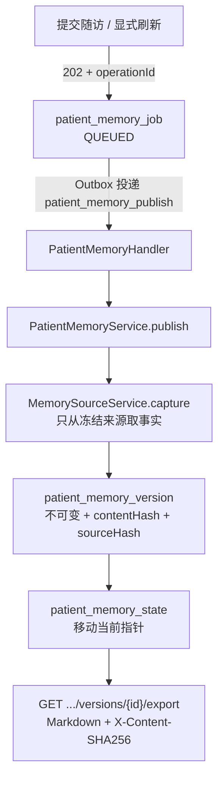

**四张表各自职责**：

| 表 | 职责 |
|---|---|
| `patient_memory_version` | 不可变版本链。`data` / `sources` 是采样当时的 JSON 快照，`markdown` 是渲染结果；`content_hash = sha256(markdown)`，`source_hash = sha256(去掉采样时间的来源清单)` |
| `patient_memory_state` | 当前发布指针，与版本链分开：一个是历史，一个是"现在看哪一版" |
| `patient_followup` | 随访原始条目，`entries` 保留用户原文（分类 + 文本），不做任何改写或摘要 |
| `patient_memory_job` | 异步发布任务，状态机 `QUEUED→RUNNING→SUCCEEDED/FAILED/CANCELLED`；同 `patient` 的 `request_sequence` 由 `patient` 行锁串行分配 |

**两条守了就不会出事的纪律**：

1. **只从冻结来源取事实**：档案修订快照（`patient_revision`）、已签发的照护修订（`care_revision` 且 `status=SIGNED`）、
   签署记录（`care_signature`）、打卡当前采样（`care_checkin`）、随访原文（`patient_followup`）。
   **指标**来自 `patient_metric`（当前可变表，没有不可变修订），因此单独登记为 `patient_metric_snapshot`
   并在来源与 Markdown 里明确写"当前状态采样，非已发布修订"——采样即冻结，但绝不冒充已核验历史。
2. **随访原文照搬**：`patient_followup.entries` 一字不改、不摘要、不过模型，控制字符之外一个字都不动；
   记忆 Markdown 里它们落在"随访反馈原文（患者自述，非医学核验）"小节。

**一处被本功能暴露并修复的真 bug**：照护 `sign` / `confirm` 在 `setStatus(SIGNED/ACTIVE)` 之后没有回写聚合，
导致"已发布修订"快照的 `status` 停留在签发前的 `DRAFT`，记忆采集按快照 `status` 判定时误拒。
已在 `CareService.snapshotRevision` 内每次从当前文档状态重算聚合并回写文档列（`§13` 的发布修订快照必须自洽）。

**两个明确的边界**（不是功能缺失，是设计取舍，见 README §9）：
- 不引入租约 / fencing token / 心跳 / attempt 表——单库单实例，写操作统一在 `patient` 行上加 `FOR UPDATE` 串行；
- 不做 Agent 自动摘录——模型摘要不是已发布事实，纳入记忆会污染"只认冻结来源"这条线。

---

## 15 Web 控制台（前端，2026-11-04 新增 + 实测）

前端不是另一个服务，而是 `src/main/resources/static` 下的原生 HTML/CSS/JS，**与后端同源**（`/` 即入口）。
Maven 直接把整目录打进 jar，运行时由 Spring 静态资源处理在根路径提供，没有独立构建、没有外部 CDN、
没有 node 依赖——断网也能开。

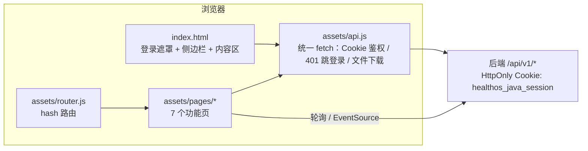

**为什么这样选型**：后端已经把 `/api/v1/*` 全部实现（认证走 Cookie、错误体统一 `{code,message}`、
乐观并发用 `expectedRevision/expectedMemoryId/operationId`、异步任务返回 `202 + jobId/runId`），
前端只需要一个"零摩擦就能跑起来"的壳把它接成可演示 UI——所以选了原生 classic script（非 ES module），
避免任何加载/MIME 约束。

**页面与后端接口映射**（全部已联调实测）：

| 前端页 | 后端域 | 关键接口 |
|---|---|---|
| `dashboard.js` | 系统姿态 | `GET /health/dependencies` |
| `patients.js` | 患者档案 | `GET /api/v1/patients`、`POST` 建档、`GET /api/v1/patients/{id}`、状态流转 |
| `intake.js` | 资料录入 | `GET/POST /api/v1/patient-intakes`、两道核查、确认建档 |
| `care.js` | 健康管理 | 报告·计划、`GET/PUT /api/v1/care/documents/{id}` 分节、签发/确认/打卡、导出、修订·审计 |
| `classics.js` | 典籍处理 | `GET/POST /api/v1/classics`、流水线节点、切片·证据·产物下载、重试 |
| `qa.js` | 智能问答 | 同步问答、异步运行（轮询 / SSE）、知识库绑定 |
| `memory.js` | 患者记忆 | 初始化、版本链、随访（202+job）、刷新、`GET .../versions/{id}/export` |

**四条前端必须守住的对接纪律**（与后端契约对齐）：

1. **Cookie 即鉴权**：登录后请求统一 `credentials:'same-origin'`，不手动拼 `Authorization`；
   `api.js` 拦截 `401` 回调 `app.js` 弹回登录页。
2. **错误体看 `message`**：`UI.toastErr` 直接展示 `GlobalExceptionHandler` 返回的 `message`，不自己拼文案。
3. **乐观并发必须带期望版本**：编辑患者 / 照护分节 / 状态流转 / 随访 / 刷新 都带 `expected*` 字段，
   收到 `409` 就提示"数据已被他人修改，请刷新"，不要吞掉。
4. **异步任务要轮询或用 SSE**：记忆发布、问答运行提交后拿 `202 + jobId/runId`，前端自行轮询状态或订阅 `EventSource`。

**文件清单**：`index.html` + `assets/{app.css,api.js,ui.js,router.js,app.js}` + `assets/pages/{dashboard,patients,intake,care,classics,qa,memory}.js`。
改页面只动 `pages/*.js`；加导航改 `app.js` 的 `NAV` 与 `index.html` 脚本引入；改完 `mvn clean package` 即重新打包。

---

## 16 模型路由配置中心：版本化 + 只追加 + 密钥不回显

模型路由解决的是"七条业务主线各自该用哪个模型、哪把密钥、什么参数"。它不是一张配置表，
而是一套**带并发控制、带密钥保护、带能力验证**的配置中心。

```mermaid
flowchart TB
    A["PUT /system/model-routes/{key}<br/>expectedVersion + config"] --> B{"版本是否落后"}
    B -->|"是"| C["409 MODEL_CONFIG_CONFLICT"]
    B -->|"否"| D["校验配置 + 归一化"]
    D --> E["追加 model_route_versions<br/>version 单调递增"]
    E --> F["model_routes 指针移到新版本"]
    F --> G["密钥 AES-256-GCM 加密<br/>AAD 绑定 pipeline/credential/version"]
    G --> H["返回 RouteView<br/>只有 credentialConfigured，无明文"]
    E --> I["model_route_probes<br/>四类合成探测留痕"]
```

**四张表的分工**：

| 表 | 职责 |
|---|---|
| `model_routes` | 每条主线的**当前版本指针**（`pipeline_key` 唯一），指向当前生效的版本行 |
| `model_route_versions` | **不可变历史**：配置 JSON、参数、指纹、变更人、变更原因。回滚 = 用旧行内容创建新行，**不拨指针、不改历史** |
| `model_credentials` | 加密后的模型密钥（密文 + `key_id` 主密钥指纹 + `version`）；同一主线可有多版密钥 |
| `model_route_probes` | 每次能力探测的留痕（四类能力各一行：状态、耗时、错误码、实际命中的模型名） |

**三条密钥纪律**：

1. **AAD 绑定**：`AES-GCM` 的附加认证数据是 `healthos:model-credential:v1:{pipelineKey}:{credentialId}:{version}`。
   密文被搬到别的行上就解不开——不是"解密失败"这种模糊报错，而是认证标签不匹配。
2. **主密钥可辨识**：`key_id` 存主密钥的 SHA-256 前 32 位十六进制。换掉 `master-key` 之后，
   旧密文报 `MODEL_CREDENTIAL_UNREADABLE`——**fail-fast，不静默降级成"没配密钥"**。
3. **配置指纹跨版本稳定**：HMAC-SHA256(主密钥, 规范化配置 + 密钥)。规范化用**手工拼固定顺序的字符串**
   而不是序列化 JSON——序列化结果的键序在不同版本可能变，跨版本就比不上了。

**四类合成能力探测**：固定输入 `Return {"ok":true}`，探测 `connectivity` / `structured` / `streaming` /
`tool_calling` 四项。整体状态只看**该主线要求的能力**是否全过。
探测**绝不碰患者数据、绝不执行工具**——它问的是"这条线通不通"，不是"业务答得对不对"。

**权限**：模型配置管理名单（`security.model-admin-users` → 角色 `MODEL_ADMIN`）与运维名单分开。
改路由是全系统生效的动作，不该和"清理孤儿文件"共用一把钥匙。所有响应带 `Cache-Control: no-store`——
这个页面的请求体里可能带密钥，被浏览器缓存住等于把它写在磁盘上。

---

## 17 多智能体协同：编排大脑在服务端

多智能体这块，难点从来不是"让模型说话"，而是**让四个角色各自守规矩、交接可追溯、来源能核对**。
所以本工程把"编排"与"作答"拆开：

```mermaid
flowchart LR
    subgraph 编排层（Java，决定守不守规矩）
        S["freezePlan<br/>场景 × 授权范围 → 角色计划"] --> P["依赖图<br/>MEMORY ‖ PIPELINE → LIFESTYLE → SYNTHESIS"]
        P --> R["readTools<br/>事实由编排层从库里读"]
        R --> V["validate<br/>五类来源校验"]
        V --> H["collectUpstream<br/>交接完整性"]
        H --> F["finalizeRun<br/>必需角色全成功才算成功"]
    end
    subgraph 执行层（可替换，只负责组织）
        E1["TemplateAgentRoleExecutor<br/>确定性模板，不调模型"]
        E2["模型执行器（待接）"]
    end
    R -.-> E1
    R -.-> E2
    E1 --> V
    E2 --> V
```

**为什么事实由编排层读**：如果工具调用由执行器自己发起，编排层就只能相信它"说自己读了"——
那样"来源校验"就成了执行器自证。所以 `readTools` 在 service 层把数据从库里读出来，
再交给执行器；执行器只能引用**它拿到的**东西。

**五类来源校验问题**：

| 码 | 含义 | 拦住了什么 |
|---|---|---|
| `EMPTY_SOURCES` | 产出里一个来源都没有 | 凭空作答 |
| `UNOBSERVED_SOURCES` | 引用了本次没读到过的来源 | 幻觉引用 |
| `TOOL_SOURCE_MISSING` | 读了工具却没引用它的产出 | 白读（读了不用，等于没读） |
| `HANDOFF_SOURCE_MISSING` | 拿了上游交接却没引用上游的来源 | 吞掉交接 |
| `ROLE_SCHEMA_INVALID` | 结果结构本身不合法 | 跑偏格式 |

**交接完整性**：下游只接受**同一次运行、同角色、`kind=role`、状态成功、且 `sha256(output)==outputHash`** 的上游节点。
少任何一条都不成立——这是防止"拿上一轮的结果当本轮证据"的关键。

**跳过而不是硬失败**：必需上游失败 → 下游标 `skipped`；但**必需角色失败 ⇒ 整轮 `FAILED`**。
缺了角色的汇报不能被描述成成功——那部分若被说成成功，比明确失败更危险。

**空结果也是合法结论**：任务状态、账号统计这类查询，结论可能就是"没有"。
"没有"同样需要来源，来源就是这次查询本身——于是补一条**采样回执**（`sample:<tool>:<采样时刻>`）。
不补的话，来源校验会以 `EMPTY_SOURCES` 把这类角色判死，而"该患者当前没有任务"恰恰是它该给出的结论。

**一处被真实链路暴露并修复的真 bug**：冻结计划里，综合角色的依赖链原本按"当前角色是否启用"判断，
于是**被禁用的生活方式角色也被算进了上游**——它永远不会产出交接，综合角色就永远被跳过、整轮必然失败。
现已改为只把"本次启用的上游"计入依赖链，并把这条规则写进了回归测试。

---

## 18 检查报告草稿：发布基线必须随草稿入库

报告草稿这条线在 Java 侧本就已完整落地（对齐原工程 `care_service.py`），这里记录的是它的关键语义与一处修复。

**发布基线（`parent_document_id`）**：草稿起草时**当前生效**的同 kind 文档。
发布（签发 / 确认）时守卫会比对"现在的生效版本"与"草稿记的基线"——
不一致就意味着这份草稿是基于旧版本起草的，直接 `409 CARE_PUBLICATION_BASE_CHANGED` 拒掉。
这是防"患者同时有两份生效报告"的机制。

**一处被真实链路暴露并修复的真 bug**：`createReport` 原先在 `insert` **之后**才给
`parent_document_id` 赋值，于是库里存的是 `null`，发布守卫每次都判定"基线已变"——
**任何患者第二次签发必然被拒**。现已把基线移到入库前定死，并统一了该列的语义
（修订来源改用 `source_report_id`），`schema.sql` 里另加幂等回填把存量草稿补齐。

---

## 19 Agent Run 事件流与控制面（2026-11-05 新增 + 实测）

### 19.1 为什么不是"日志表"

协同运行的状态变化原本只能从 `agent_node.status` 反推：知道"现在是什么样"，
**不知道"怎么变成这样的"**。补齐事件流时最容易走的两条歪路是——
把事件当业务日志写（失败即丢、顺序靠时间戳）或者把 SSE 当唯一通道（断线就丢历史）。

这里的定调是：**轮询是主通道，SSE 只是同一份事件的流式包装**。
两者读的都是 `agent_run_event`，SSE 断了重连只需带上 `afterSeq`，不会漏也不会重。

### 19.2 序号分配必须原子

`seq` 由数据库发，不由应用算：

```sql
UPDATE agent_run SET event_seq = event_seq + 1
 WHERE id = ? RETURNING event_seq
```

配 `UNIQUE (run_id, seq)`。如果改成应用侧"先查 max(seq) 再 +1"，两个线程并发就是
`duplicate key`，而事件写入失败会把整轮执行打断——事件本该是旁路，不能反过来掐死主链路。

```mermaid
sequenceDiagram
    participant C as AgentCollaborationService
    participant S as AgentRunEventService
    participant DB as agent_run / agent_run_event
    participant P as 轮询客户端
    participant E as SSE 客户端

    C->>S: emit(runId, "node.completed", nodeId, status)
    S->>DB: UPDATE agent_run SET event_seq=event_seq+1 RETURNING event_seq
    DB-->>S: seq = N
    S->>DB: INSERT agent_run_event(run_id, N, type, node_id, status)
    Note over S,DB: 失败只记 warn，不向上抛<br/>事件是旁路，不能打断业务

    P->>DB: GET /events?afterSeq=N-1
    DB-->>P: items[nextSeq=N, eventSeq, status]
    E->>DB: GET /stream?afterSeq=N-1 (SSE)
    DB-->>E: id: N / event: node.completed / data: {...}
```

### 19.3 事件词表（12 种，收口在 `AgentRunContract`）

| 分组 | 事件 | 触发点 |
|---|---|---|
| run 级 | `run.queued` | 提交入库，`eventSeq=0/version=1/deadlineAt` 同一条 UPDATE |
| | `run.started` | 执行线程拿到任务 |
| | `run.succeeded` / `run.failed` / `run.cancelled` | `finalizeRun` 的终态 |
| | `run.retry_requested` | `POST /retry` 之后重开 |
| node 级 | `node.started` | `recordNode` 前 |
| | `node.completed` / `node.failed` / `node.skipped` / `node.cancelled` | `recordNode` 落库后按 `status` 折算 |
| 审计 | `node.payload_read` | 读节点正文（脱敏或 `full`）都留痕 |

**`detail` 列只落库不出接口**。事件接口对外只有 `seq` / `type` / `nodeId` / `status` / `createdAt`——
detail 里可能带模型输入片段。要看内容走 `/nodes/{nodeId}`，那条路有脱敏、有审计、有保留期。

### 19.4 控制面语义（cancel 与 retry 都不"聪明"）

| 当前状态 | `POST /cancel` | `POST /retry` |
|---|---|---|
| `QUEUED` | 置 `CANCELLED`，已排队节点改 `cancelled` | **不新建**，原样返回（响应丢失对账） |
| `RUNNING` | 置 `CANCELLED`，下一个节点边界停下 | **不新建**，原样返回 |
| `SUCCEEDED` | 原样返回（终态不可逆，幂等） | `409 AGENT_RUN_STATE`（成功不可重试） |
| `FAILED` | 原样返回 | 清 `error/result/started/completed`，写新 `deadline_at`，重开 |
| `CANCELLED` | 原样返回 | `409 AGENT_RUN_STATE`（取消不可逆） |

三条硬约束：

1. **每次控制都必须带 `expectedVersion`**，不匹配就 `409 AGENT_VERSION_CONFLICT`。
   控制面是"读—判—写"，没有版本号就是拿用户看到的旧状态去覆盖别人的新状态。
2. **`cancel` 是标记，不是抢占**。执行线程不会被打断，它只是下一个节点前看到 `CANCELLED` 而停。
   想真抢占需要节点级租约与心跳，那是另一件事（见 README §11）。
3. **`deadline_at` 超时不重放**。判定在节点边界，超时即 `FAILED`，
   不会因为"再试一次说不定就好了"而延长——超时本身就是结论。

### 19.5 断点续跑：只复用角色节点

`retry` 复用 `kind='role' AND status='succeeded'` 的节点（`AgentNodeMapper.selectSucceededRoles`），
**校验节点与工具节点一律重跑**。理由很直接：复用校验等于跳过校验，
省下的那点时间是拿"来源可能已变"换的。

`get()` 里加了 `orderByAsc(createdAt)`——重试后同一 `ordinal` 会有新旧两批节点，
只按 `ordinal` 排序，返回哪一条取决于数据库心情。

**一处被真实链路暴露并修复的真 bug**：`AgentRun.eventSeq` / `version` 原本没有
`@TableField(updateStrategy = FieldStrategy.NEVER)`。`finalizeRun` 走 `updateById`，
把内存里那份**旧的 `eventSeq=0`** 写了回去，下一次 `emit` 拿到 `seq=2` 就撞
`uk_agent_run_event_seq`。表现是"事件缺了 `run.succeeded`、`eventSeq` 涨不上去、
读节点正文直接 500"——三处症状同一个根因。修法是水位列对 `updateById` 永久只读，
控制面一律用显式列更新（`Wrappers.<AgentRun>update().set(...)`）。

---

## 20 Agent Lab：工具目录与三步协议校验（2026-11-05 新增 + 实测）

### 20.1 它解决什么问题

"Agent 能用哪些工具"这件事，以前只能靠读代码回答。Agent Lab 把答案变成接口：
目录（`GET /agent-lab/catalog`）、探活（`POST /services/{id}/probe`）、
调用（`POST /services/{id}/call`）。

关键是**发现集必须等于授权集**。只校验"调用的工具存在"是不够的——
如果 `tools/list` 返回 6 个而授权只有 4 个，说明要么注册表多给了、要么授权算错了，
两种都不该继续跑。

### 20.2 两种传输层，同一段编排

三步（`initialize → tools/list → tools/call`）走 `spi/agent/McpServerBridge` 端口，
`AgentLabService` 只认这个端口，因此"进程内"与"真子进程"可以并排存在、逐字段对照：

| | `in-process`（默认） | `stdio` |
|---|---|---|
| 谁声明工具 | 本进程的 `AgentLabToolService.discover()` | 子进程 `tools/mcp-server/patient-business.js` 的 `SCOPE_TOOLS` 表 |
| 协议往返 | 无（同一 JVM 内方法调用） | 真 JSON-RPC 2.0，**一行一条 JSON**（不是 LSP 的 `Content-Length` 分帧） |
| initialize 耗时 | 恒 0 | ≈135ms（几乎全是 node 启动） |
| 依赖 | 无 | Node.js ≥18 |
| 证明什么 | 授权与回执语义正确 | **外部客户端真能按协议接进来** |

```mermaid
sequenceDiagram
    participant A as 调用方
    participant L as AgentLabService
    participant N as node 子进程<br/>patient-business.js
    participant E as /internal/agent-lab/tools
    participant T as AgentLabToolService
    participant DB as PostgreSQL

    A->>L: POST /probe {patientId, scopes}
    L->>L: 按登录态签发凭证 mgrant_xxx（TTL 60s）
    L->>N: ProcessBuilder 起进程<br/>env: MCP_GRANT / MCP_SCOPES / MCP_TOOL_ENDPOINT / MCP_INTERNAL_TOKEN
    L->>N: initialize（JSON 一行）
    N-->>L: protocolVersion=2024-11-05, serverInfo
    L->>N: notifications/initialized（无 id 通知）
    L->>N: tools/list
    N-->>L: 按 MCP_SCOPES 裁剪后的工具清单
    Note over L: 比对 AgentLabContract.AUTHORIZED_TOOLS<br/>不一致 → AGENT_DISCOVERY_MISMATCH
    L->>N: 关 stdin → 子进程退出

    A->>L: POST /call {tool, scopes}
    L->>N: 起新进程 + initialize + tools/call
    N->>E: POST /{tool} {grant, arguments}（X-Internal-Token）
    E->>E: 回环？令牌？凭证？工具在授权范围内？
    E->>T: execute(tool, grant.owner, grant.patientId, 白名单参数)
    T->>DB: 按 owner + patientId 查
    DB-->>T: 行
    T-->>E: structuredContent
    E-->>N: {structuredContent}
    N-->>L: CallToolResult{structuredContent}
    L-->>A: 200 回执 + outputHash
```

### 20.3 三条不能省的约束

1. **只递凭证，不递身份**。父进程按当前登录态签发一张随机 ID 的短命凭证，
   子进程回调时带它，端点查表才还原 `owner/patientId`。请求体里没有这两个键，
   子进程因此**没有能力**指定读谁的数据。若把 `MCP_OWNER` 塞进环境变量，
   "服务端锁定身份"就降级成"客户端声明身份"——那正是这条链路最容易破的地方。
2. **声明必须独立**。父进程只传"范围"，`范围 → 工具` 的映射写在 JS 里，
   与 Java 侧的 `AUTHORIZED_TOOLS` 是两份代码。两份才对得住"发现集等于授权集"这条校验。
3. **一次操作一个进程**。常驻要复用就得把身份塞进请求；而省下的 130ms 对诊断控制台毫无价值。

### 20.4 越权工具为什么返回 200 而不是 403

回执是**证据**，不是响应码。`MCP_TOOL_REJECTED` 落库 + 200 返回，意味着
"这次调用确实发生过，并且被拒了"——审计上可查。若抛 4xx，回执就只能靠日志，
而日志会滚掉。

同理 `MCP_OUTPUT_INVALID`（工具输出不符合 schema）与 `MCP_UNAVAILABLE`
（子进程起不来 / 超时 / 协议错误）也是回执状态，不是 HTTP 错误码。
桥接层的细分码（`MCP_TIMEOUT` / `MCP_PROCESS_EXITED` / `MCP_PROTOCOL_ERROR`）
不外泄，统一收敛成契约里那几个——客户端不该因为"服务端换了传输层"而收到新错误名。

**失败阶段要能定位**：`McpBridgeException` 带 `stage`，回执 detail 里落 `failedAt`。
没有它，一次握手失败只能记成"没跑通"，而"是 initialize 挂了还是 tools/list 挂了"
恰恰是最有用的一条信息。

### 20.5 硬边界

- **`stdio` 形态不常驻**：只用于诊断控制台，不是业务链路依赖。业务链路仍走进程内工具调用。
- **内部端点的信任边界在子进程**：令牌 + 回环 + 短命凭证挡住"别人打进来"和"子进程指定身份"，
  但挡不住"拿到令牌的人改脚本"。所以脚本零依赖、不碰数据库、不产生出站连接。
- **降级要及时**：node 不在 PATH 上时，probe 在 44ms 内返回
  `failed + MCP_UNAVAILABLE + failedAt=initialize`，不等满 20s 超时；
  目录接口与 `/health/dependencies` 完全不受影响。
- `CATALOG_VERSION = agent-lab-m6-v1`：目录一变，调用方缓存必须失效。
  改工具清单而忘了改版本号，比不改更糟——缓存会一直返回旧目录。
- `MAX_SCOPES = 5`：范围是有序集合，不是无限续杯。
- `STALE_SECONDS = 300` / `INTERRUPTED_SECONDS = 35`：探活结果的新鲜度与"卡住"的判定线，
  两个数都在契约里，别散落在服务里。

---

## 21 QA 书签与单路检索诊断（2026-11-05 新增 + 实测）

### 21.1 书签：引用快照要冻结

`qa_memo` 存的是**引用快照**，不是 `message_id` 的指针：

- `source_message_id` 唯一 → 同一条消息只能收藏一次（重复收藏返回已有那条，不新建）。
- `question` / `content` / `content_hash` / `evidence_snapshot` / `source_versions`
  都是**收藏那一刻**的问、答、正文哈希、引用与来源版本，之后源消息被清理、被重跑、
  引用数据增长，书签都不变。

这两条合起来才叫"书签"。只存指针，等于存了个会变的引用；只存正文不存引用，
等于把可核验性丢了。

### 21.2 诊断：只跑检索一路，失败不抛给 Outbox

`ragflow_diagnostic` 模式**不调模型**，只跑检索，落库的是**两层**状态：

| 字段 | 取值 | 含义 |
|---|---|---|
| `qa_diagnostic.status`（运行层） | `QUEUED` / `RUNNING` / `SUCCEEDED` / `FAILED` | 这次诊断跑没跑完 |
| `result.executionStatus`（结论层） | `SUCCEEDED` / `NO_EVIDENCE` / `DEGRADED` | 结论是什么性质 |
| `result.retrievalStatus` | `hit` / `no_hit` / `unknown` | 检索到没到东西 |
| `result.resultKind` | `retrieval_only` / `no_evidence` / `model_unknown_retrieval` | 结论能不能用 |
| `result.usableForSummary` | boolean | 是否可作为摘要依据 |
| `result.citationStatus` | `cited` / `not_applicable` | 有无可用引用 |

关键取舍：**运行层永远是 `SUCCEEDED`，除非诊断自己崩了**。「确实没检到」
（`executionStatus=NO_EVIDENCE`）与「检索依赖不可用」（`DEGRADED`）都是**有效结论**，不是故障。
如果把它们抛给 Outbox，就会无限重试一个永远不会变的结果——既烧资源又污染失败率。
只有"诊断本身没跑成"才 `FAILED`，并且**保留 draft**，下次重试接着用。

`operation_key` 唯一 → 同一诊断键幂等。响应码：首次 `202`，
同键重复调 `200`，参数不可诊断 `422`。

证据侧对外只暴露 `citedEvidenceIds` 与 `citationStatus`，不回吐正文片段。

---

## 22 患者资料草稿与记忆 Agent 摘录（2026-11-05 新增 + 实测）

### 22.1 草稿：暂存不是确认

`patient_review_draft` 只有 `basic` / `clinical` 两个 scope，一把 `base_revision`
锁"起草时基于的正式修订"，一把 `version` 锁"草稿自己的版本"（请求体里叫 `expectedVersion`）。
两把锁方向不同：前者防"拿着旧底稿覆盖新修订"，后者防"同一份草稿被并发覆盖"。

| 场景 | 结果 |
|---|---|
| 首次 PUT | `200`，`version=1` |
| 版本匹配 | `200`，`version+1` |
| `expectedVersion` 不匹配 | `409 DRAFT_VERSION_CONFLICT` |
| `baseRevision` 落后于正式修订 | `409 DRAFT_REVISION_CONFLICT` |
| 丢响应重放（`version==expected+1` 且 payload、baseRevision 相同） | `200` 直接返回，不重复写入 |

**草稿永不改正式修订、永不改确认状态**。这是权限边界：暂存是"我还没想好"，
确认是"我签了字"。混在一条链路上，审计就分不清谁签的字。

`payload` 走白名单字段，多余字段丢掉而不是报错——前端多传一个字段不该让医生丢草稿。

### 22.2 摘录：逐字，且不并入正式记忆版本

`memory_agent_note` 的候选是 `PENDING`，三道闸：

1. **逐字校验**：`content.contains(quote)`，且必须覆盖全部分类。
   摘错一个字就是编，没有"大致意思对"这种说法。
2. **`candidateHash`**：发布时比对，防候选在库里被改过。
3. **`sourceHash`**：来源快照变了就 `409 MEMORY_AGENT_SOURCE_CHANGED` 拒发布。

发布是**显式动作**（`POST /memory/agent-notes/{id}/publish`），不是"存了就算"。
且发布凭据落在 note 行内，**不并入 `patient_memory_version`**——
记忆版本的红线是"只认已发布修订"，掺一句模型摘要就破了这条线。

`(owner, patient_id, operation_id)` 唯一 → 摘录幂等，
`agent-followups` 重复提交返回同一条候选，不会攒出一堆重复。

---

## 23 本地向量检索：融合排序与降级（2026-11-05 新增 + 实测）

### 23.1 词面召回的盲区

原先的本地打分是中文二元组重合度。它有两个硬伤：

1. **同义改写召回不到**——问「补肾的药材」，正文写「补益肝肾」，一个二元组都不重合；
2. **长句靠体量刷分**——命中率高但信息密度低的段落会挤掉真正相关的那一段。

补向量一路不是为了"更先进"，是为了消掉第 1 条。第 2 条靠融合权重部分缓解。

### 23.2 两条路径，同一份数据

```mermaid
sequenceDiagram
    participant P as 流水线 index 节点
    participant R as 检索（QaService）
    participant V as ChunkVectorService
    participant E as EmbeddingModel（Ollama bge-m3）
    participant DB as chunk_vector

    P->>V: indexDocument(documentId)
    V->>DB: 读已存向量（按 model）
    V->>V: 比对 content_hash，只挑新增/变了的切片
    V->>E: embedBatch(texts)（16 条一批）
    E-->>V: 归一化向量
    V->>DB: 删旧行 + 插入（(chunk_id,model) 唯一）
    Note over V,DB: 失败只写 note，节点仍 SUCCEEDED

    R->>V: search(documentId, question)
    V->>DB: 无向量？→ 懒补建一次（in-flight 去重）
    V->>E: embed(question)
    V->>V: 余弦 = 点积（两侧都已归一化）
    V-->>R: chunkId → [0,1]
    R->>R: HybridScorer：0.6×向量 + 0.4×词面
```

### 23.3 融合公式与两个门槛

```
score = w × clamp(cos, 0, 1) + (1 − w) × 词面覆盖率      w = vector-weight = 0.6
准入：词面覆盖率 > 0  或  向量分 ≥ vector-min-score (0.45)
```

三个刻意的选择：

| 选择 | 理由 |
|---|---|
| **加权和，不是两段式**（向量召回→词面重排） | 两段式有两个不可解释的门槛，且第二段看不到被第一段丢掉的候选；加权和的分数能拆开看 |
| **不直接相乘** | 乘法会让任一侧为 0 就整体为 0：同义改写（向量高、词面 0）与关键词命中（词面高、向量一般）都会被误杀 |
| **纯向量召回要过 0.45** | 否则任何问题都能从任何文档里挑出 5 条——"总有话说"比"没话说"更危险 |

`HybridScorer.Hit` 同时带 `lexical` 与 `vector` 两个分量：排障时能一眼看出
"这条是被向量顶上来的，词面一个字都没对上"，而不是面对一个混合黑盒分。

### 23.4 降级：三处，全部留痕

| 位置 | 失败表现 | 处理 |
|---|---|---|
| 索引期（流水线） | Ollama 不可用 | 节点仍 `SUCCEEDED`，detail 写 `degraded: embedding_degraded:CODE（检索退回词面打分）` |
| 检索期（问答） | 问题向量化失败 | 本次检索退回词面打分，问答正常返回；日志 warn |
| 探活（`/health/dependencies`） | 模型不在 `/api/tags` 里 | `embedding: ollama:bge-m3:unavailable`，但 `status` 仍可为 `ready`（可选增强不拖垮就绪判定） |

**失败后安静 60 秒**（只对 `retryable=true` 的失败：连不上、5xx、超时）。
不冷却的话，每次问答都要等一次超时；永久放弃的话，Ollama 恢复了也没人知道。

### 23.5 为什么不装 pgvector

官方 `postgres:16` 镜像不带该扩展（`pg_available_extensions` 里 0 命中），装它要重建镜像或
换 `pgvector/pgvector` 镜像。本切片的候选集是"单篇文档的切片"，上限 `candidate-limit=200`，
Java 侧算 200 次 1024 维点积是毫秒级。所以向量存 JSON 数组，`psql` 里还能直接看懂。

上 pgvector 的路径已经想好：列换成 `vector(1024)`、加 HNSW 索引、`ORDER BY vector <=> ?`，
**只动 `ChunkVectorService` 的两句 SQL**，`KnowledgeBase` 契约与上层全部不动。

### 23.6 实测（2026-11-05，本机 Ollama 0.40.14 + bge-m3）

| 场景 | 结果 |
|---|---|
| 索引期 | 6 片 → `chunk_vector` 6 行、`dimension=1024`，节点 `latency_ms=1916`（含模型首次加载） |
| 懒补建 | 历史文档 2 片 → 首查自动写入 2 行，无需手工回填 |
| **同义查询对照** | 「补肾的药材有哪些？」向量开：`OK` + 2 条引用（top `0.3865`，命中「熟地黄…补益肝肾」）；向量关：`INSUFFICIENT_EVIDENCE` + 0 条 |
| 关键词查询 | 「四君子汤主治什么？」两条路都能答（词面仍是主力，向量未抢位） |
| 依赖不可用 | `base-url` 指向死端口：`embedding: unavailable`、`status: ready`、问答照常返回（0.78s） |
| 无关文档 | 拿一份 README 样本文档问中医问题 → 正确拒绝（`INSUFFICIENT_EVIDENCE`），不是硬凑 |

### 23.7 仍然没有的能力

- **没有 cross-encoder 重排**：本机 Ollama 0.40 没有 `/api/rerank`，`bge-reranker-v2-m3`
  的 capabilities 只有 `completion`，调 `/api/embed` 直接回
  "This server does not support embeddings"。要真重排得起 llama.cpp server（`/rerank`）
  或走 RAGFlow 的 `rerank_id`。**没端点就不假装有**。
- **没有 ANN**：规模上去必须换 pgvector / 独立向量库。
- **权重是样本调出来的**：换模型或换语料要重调，别把 0.6/0.45 当常数。

## 24 模型成本与配额：记账与闸门（2026-11-05 新增 + 实测）

### 24.1 一条调用的完整路径

```mermaid
sequenceDiagram
    participant B as 业务（问答 / 抽取 / 记忆发布）
    participant P as OpenAiCompatibleLlmProvider
    participant M as ModelUsageService
    participant U as 上游模型
    participant DB as model_usage

    B->>P: chat(route, prompt)
    P->>M: assertWithinQuota(pipelineKey, model)
    M->>DB: SUM(total_tokens), SUM(cost_micros) WHERE scope_key=? AND created_at>=今日00:00(+08)
    alt 已达上限
        M-->>P: throw ModelQuotaExceededException(used, limit)
        P-->>B: 429 MODEL_QUOTA_TOKENS_EXCEEDED（请求没发出去，钱没花）
    else 未达上限
        M-->>P: ok
        P->>U: POST /v1/chat/completions
        U-->>P: choices[0] + usage{prompt,completion,total}
        P->>M: record(scope, providerId, model, traceId, usage)
        M->>DB: INSERT 一行（cost_micros = tokens × 单价，未知单价则 NULL）
        P-->>B: 答案
    end
```

顺序是这条链路唯一不能错的地方：**闸门在请求之前**，记账在响应之后。
反过来写（先调再查配额）在测试里看不出来，在生产上是"每月超支一次"。

### 24.2 为什么金额用微元整数

单价是「货币 / 百万 token」，落库是微元（1 单位货币 = 1e6 微元）。两者正好抵消：

```
cost_micros = 缓存命中输入 × 命中价 + (输入 − 命中) × 未命中价 + 输出 × 输出价
              （峰时再整体 × peak_multiplier）
```

于是全程整数运算，没有"先除 1e6 再乘 1e6"的浮点往返。
实测（真实 DeepSeek 上游，`deepseek-v4-pro`，UTC 03:01 属峰时）：

```
(512 × 0.022 + 39 × 0.66 + 2281 × 1.98) × 2 = 9107 微元 = $0.009107
```

**为什么要分成三档而不是一个输入价**：官方命中价与未命中价差 50 倍（0.022 vs 0.66）。
把 512 个命中 token 按未命中价算，这一笔就会从 0.0091 虚高到 0.0191 美元；
反过来漏算输出价则会把成本压到只剩零头。三档是"能对上账单"的最小口径。

**为什么命中数要落库**（`cached_prompt_tokens`）：上面那行数字如果没有 `512`，
事后只有 `551/2281`，任何人都无法复算出 9107——成本会退化成黑盒，
而黑盒的成本数字比"没有成本"更危险：它会被人当成真的。

**为什么峰谷乘总额而不是逐档乘**：官方三档在峰时都正好翻倍（0.022→0.044 / 0.66→1.32 /
1.98→3.96），乘总额与逐档乘等价，前者少三分之一的代码。若哪天官方只对输出加价，
这个等价就不成立——那时必须改成逐档乘，所以 `Price` 里保留的是基准价而不是峰价。

### 24.3 三条刻意的取舍

1. **没单价就不算钱**：`cost_micros` 允许 NULL，看板单列 `unpricedCalls`。
   编一个价格会让"总花费"看起来是准确数字，而其中一部分是假的——比留空危险得多。
2. **记账失败不阻塞业务**：写库异常只留日志。钱已经花了，不能因为统计表写不进去把答案丢掉。
3. **配额按主线不按账号**：成本是主线在烧，按账号限流会把"某人今天问得多"与
   "某条主线失控重试"混为一谈，而后者才会烧穿预算。

### 24.4 剩余偏差（写在明处）

- 只有日累计窗口，没有小时级窗口与并发预扣：并发打满时可能有 N 个请求同时通过闸门。
- 只统计 chat 调用；embedding 不计费（本地 `bge-m3`），接云端 embedding 时要另设口径。
- 峰谷只按 UTC 工作日建模，**中国法定节假日不建模**：节假日当天按峰价估算，属保守高估。
  引入一张需要每年维护的假期表，成本远大于这点误差。
- 价目表是配置而不是从账单拉取：单价已与官方文档逐档对齐、金额算式已用真实 `usage` 复算，
  但**未与上游账单对账**（对账需要当期账单接口，不在本期范围）。

---
